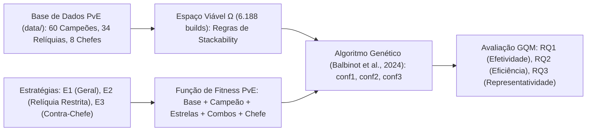

# Otimização de Builds em Legends of Runeterra (O Caminho dos Campeões) Utilizando Algoritmo Genético

> **Disciplina:** Fundamentos de Inteligência Artificial  
> **Trabalho Prático:** Extensão de Artigo Científico Recente  
> **Autor:** Rafael Gomes Oliveira Santos  
> **Artigo Base:** *Developing Competitive Strategies for Legends of Runeterra using Genetic Algorithm* (Balbinot, Costa, Souza & Souza · XXIII SBGames, 2024)

---

## 📌 1. Visão Geral e Objetivo da Extensão

Este projeto implementa a extensão proposta na primeira etapa da disciplina sobre o trabalho de **Balbinot et al. (2024)**, publicado no *XXIII Simpósio Brasileiro de Jogos e Entretenimento Digital (SBGames 2024)*.

No artigo original, os autores utilizaram um **Algoritmo Genético (AG)** para automatizar a escolha de *lineups* competitivos de 3 baralhos no modo PvP (*Riot Lock*), avaliando três estratégias ($E_1$: Vitória Geral, $E_2$: Banimento Fixo, $E_3$: Contra-Deck Específico) sob três configurações de parâmetros (`conf1`, `conf2`, `conf3`).

Seguindo rigorosamente o objetivo proposto na apresentação inicial da disciplina:
1. **Arquitetura do Algoritmo Genético Preservada:** Mantém-se a estrutura evolutiva do artigo base (indivíduo representado por uma tripla, cruzamento posicional em dois passos com permutação de ordem dos pais conforme a Figura 4 do artigo original, mutação pontual guiada pela taxa $TM$ e elitismo).
2. **Migração de Domínio e Base de Dados (PvP $\rightarrow$ PvE):** Transpõe-se o problema para o modo *roguelike* PvE **O Caminho dos Campeões** (*The Path of Champions* — PoC), utilizando uma base curada da comunidade com **60 Campeões**, **34 Relíquias** (Comuns, Raras e Épicas), **8 Combos de Relíquias** e **8 Chefes Mundiais**.
3. **Reformulação da Função de Avaliação (Fitness):** Substitui-se o cálculo de *winrate* PvP por uma função de aptidão multidimensional voltada à sinergia PvE (Poder Base, Sinergia Campeão-Relíquia, Amplificação por Poder Estelar, Sinergia entre Relíquias/Combos e Efetividade contra Chefe/Mutadores).



---

## 🔄 2. Mapeamento Direto com o Artigo Base (SBGames 2024)

| Dimensão | Artigo Base (Balbinot et al., 2024 — PvP) | Extensão Desenvolvida (PoC — PvE) |
|---|---|---|
| **Cromossomo (Indivíduo)** | Tripla de 3 Arquétipos $(d_1, d_2, d_3)$ | Tripla de 3 Relíquias $(r_1, r_2, r_3)$ |
| **Restrições de Domínio** | Regra *Riot Lock* (sem repetir campeões ou combinação de regiões) | Regra de *Stackability* (proibido duplicar relíquias não acumuláveis ou Épicas) |
| **Estratégia $E_1$** | Otimização pela taxa de vitória geral | Otimização geral para o Campeão (sem chefe específico) |
| **Estratégia $E_2$** | Otimização excluindo um arquétipo banido ($d_x$) | Otimização excluindo uma relíquia restrita/indisponível ($r_x$) |
| **Estratégia $E_3$** | Otimização focada em vencer um deck alvo ($d_y$) | Otimização focada em neutralizar os mutadores de um Chefe alvo ($B_{oss}$) |
| **Metodologia de Avaliação** | Modelo GQM (Basili & Weiss, 1984) — `conf1`, `conf2`, `conf3` (30 execuções) | Modelo GQM (Basili & Weiss, 1984) — `conf1`, `conf2`, `conf3` (30 execuções) + Busca Exata (*Ground Truth*) |

---

## 📊 3. Síntese dos Resultados Experimentais (GQM)

Seguindo o protocolo experimental da Seção 5 de Balbinot et al. (2024), cada configuração (`conf1`: $P=10, TM=0.3, G=10$; `conf2`: $P=20, TM=0.5, G=50$; `conf3`: $P=30, TM=0.7, G=100$) foi executada **30 vezes**, confrontando o resultado com o **Ótimo Global Exato** obtido via busca exaustiva sobre todas as **6.188 combinações válidas**:

| Campeão | Config | $P$ | $TM$ | $G$ | Ótimo Global Exato | Fitness Médio (AG) | Otimalidade (%) | Tempo Médio (ms) |
|---|---|---|---|---|---|---|---|---|
| **Jinx** | `conf1` | 10 | 0.3 | 10 | 18.07 | 14.94 | 82.7% | 1.01 ms |
| **Jinx** | `conf2` | 20 | 0.5 | 50 | 18.07 | 18.07 | **100.0%** | 12.28 ms |
| **Jinx** | `conf3` | 30 | 0.7 | 100 | 18.07 | 18.07 | **100.0%** | 42.84 ms |
| **Yasuo** | `conf1` | 10 | 0.3 | 10 | 17.77 | 13.16 | 74.0% | 1.09 ms |
| **Yasuo** | `conf2` | 20 | 0.5 | 50 | 17.77 | 17.77 | **100.0%** | 12.81 ms |
| **Yasuo** | `conf3` | 30 | 0.7 | 100 | 17.77 | 17.77 | **100.0%** | 43.96 ms |
| **Aurelion Sol** | `conf1` | 10 | 0.3 | 10 | 19.57 | 14.67 | 75.0% | 1.31 ms |
| **Aurelion Sol** | `conf2` | 20 | 0.5 | 50 | 19.57 | 19.57 | **100.0%** | 13.22 ms |
| **Aurelion Sol** | `conf3` | 30 | 0.7 | 100 | 19.57 | 19.57 | **100.0%** | 47.00 ms |
| **Swain** | `conf1` | 10 | 0.3 | 10 | 18.73 | 14.37 | 76.7% | 1.15 ms |
| **Swain** | `conf2` | 20 | 0.5 | 50 | 18.73 | 18.72 | 99.9% | 14.78 ms |
| **Swain** | `conf3` | 30 | 0.7 | 100 | 18.73 | 18.73 | **100.0%** | 48.14 ms |

* **RQ1 (Efetividade):** Assim como observado no artigo base, `conf1` ($G=10$) apresenta convergência prematura (74% a 82.7% do ótimo), enquanto `conf3` ($P=30, TM=0.7, G=100$) atinge **100.0% de otimalidade** em todos os cenários avaliados.
* **RQ2 (Eficiência):** O tempo médio na configuração `conf3` fica entre **42 ms e 48 ms** (e ~13 ms em `conf2`), mantendo a resposta abaixo do limiar de 200 ms reportado no artigo base.
* **RQ3 (Representatividade):** As builds encontradas coincidem integralmente com as recomendações *Best-in-Slot* (Tier S+/S) das planilhas comunitárias de referência (`data/poe_legends_of_runeterra_builds.csv`) e demonstram adaptação autônoma aos mutadores de chefes na Estratégia $E_3$.

---

## 📂 4. Estrutura Organizacional do Projeto

```text
Fundamentos de IA/
├── data/
│   ├── lor_genetic_algorithm_base.csv       # Base estruturada de Campeões, Relíquias e Chefes
│   ├── poe_legends_of_runeterra_builds.csv  # Base de builds de referência da comunidade (Tier List)
│   └── database.json                        # Base consolidada exportada pelo carregador
├── src/
│   ├── __init__.py                          # Exportação pública do pacote
│   ├── models.py                            # Estruturas de dados (Relic, Champion, Boss, Build, FitnessBreakdown)
│   ├── data_loader.py                       # Leitura dos CSVs e matrizes de sinergia
│   ├── fitness.py                           # Função de Fitness PvE multidimensional
│   ├── genetic_algorithm.py                 # Motor do Algoritmo Genético (Balbinot et al., 2024)
│   ├── comparison.py                        # Busca Exaustiva Exata (Ground Truth de 6.188 combinações)
│   └── optimizer.py                         # Orquestrador das estratégias E1, E2 e E3
├── examples/
│   ├── demo_cli.py                          # CLI para execução de E1, E2, E3 e comparação entre chefes
│   ├── benchmark_vs_exact.py                # Replicação do experimento GQM (conf1, conf2, conf3 x 30 repetições)
│   └── run_all_champions.py                 # Geração em lote das builds ótimas para os 60 campeões
├── tests/
│   ├── test_models.py                       # Testes de regras de acúmulo (stackability)
│   ├── test_data_loader.py                  # Testes de integridade da base de dados
│   ├── test_fitness.py                      # Testes dos componentes da função de fitness
│   ├── test_genetic_algorithm.py            # Testes de cruzamento, mutação, reparo e convergência
│   ├── test_comparison.py                   # Testes de validação contra a busca exata
│   └── test_end_to_end.py                   # Testes integrados das estratégias E1, E2 e E3
├── Docs/
│   ├── RELATORIO_TECNICO.md                 # Relatório acadêmico completo da extensão
│   ├── FORMULACAO_MATEMATICA.md             # Detalhamento matemático do cromossomo e fitness
│   ├── TREINAMENTO_APRESENTACAO.md          # Manual de defesa, roteiro cronometrado e sabatina
│   ├── APRESENTACAO_RESULTADOS.md           # Síntese estruturada para a apresentação final (5 a 9 min)
│   ├── GUIA_DE_USO.md                       # Instruções de execução dos experimentos
│   ├── ALL_CHAMPIONS_BUILDS.md              # Catálogo gerado para os 60 campeões
│   └── slides/                              # Slides e recursos de apresentação
├── web/                                     # Interface gráfica interativa (HTML5, CSS3, JS)
├── web_app.py                               # Servidor web local zero-dependências
├── LICENSE                                  # Licença de código aberto (MIT)
├── requirements.txt                         # Dependências do projeto
└── README.md
```

---

## 🚀 5. Como Executar

Requer apenas **Python 3.10+** (utiliza exclusivamente a biblioteca padrão do Python, sem dependências externas).

### 1. Executar a Suíte de Testes Unitários (31 testes)
```powershell
python -m unittest discover tests -v
```

### 2. Reproduzir o Experimento Científico do Artigo (`conf1`, `conf2`, `conf3` com 30 repetições)
```powershell
python examples/benchmark_vs_exact.py
```

### 3. Executar a CLI para as Estratégias $E_1$, $E_2$ e $E_3$
```powershell
# Estratégia E1 (Geral):
python examples/demo_cli.py --champion Jinx --stars 3

# Estratégia E2 (Exclusão/Banimento Fixo de Relíquia):
python examples/demo_cli.py --champion Jinx --stars 3 --ban-relic "The Loose Cannon's Payload"

# Estratégia E3 (Contra-Chefe Específico):
python examples/demo_cli.py --champion Jinx --stars 3 --boss Lissandra

# Comparar adaptação do mesmo campeão contra múltiplos chefes (Teemo, Aurelion Sol, Lissandra, Swain):
python examples/demo_cli.py --champion Yasuo --stars 3 --compare-bosses
```

### 4. Gerar o Catálogo Completo para os 60 Campeões
```powershell
python examples/run_all_champions.py
```

### 5. Iniciar a Interface Web Interativa (Zero Dependências Externas)
```powershell
python web_app.py
```
*Inicia o servidor HTTP nativo e abre no navegador (`http://localhost:8000`) para experimentação visual de builds, comparação contra chefes e visualização do detalhamento do fitness.*

---

## 📚 6. Referências Bibliográficas Verificadas

Todas as referências abaixo constam e foram verificadas diretamente a partir do artigo base da disciplina:

* **BALBINOT, R. A.; COSTA, L. M.; SOUZA, A. C. C.; SOUZA, F. C. M.** Developing Competitive Strategies for Legends of Runeterra using Genetic Algorithm. In: *XXIII Simpósio Brasileiro de Jogos e Entretenimento Digital (SBGames 2024)*, Manaus/AM, 2024.
* **BASILI, V.; WEISS, D.** A methodology for collecting valid software engineering data. *IEEE Transactions on Software Engineering*, v. 10, n. 6, p. 728–738, 1984.
* **CHEN, Z.; AMATO, C.; NGUYEN, T.-H. D.; COOPER, S.; SUN, Y.; EL-NASR, M. S.** Q-deckrec: A fast deck recommendation system for collectible card games. In: *2018 IEEE Conference on Computational Intelligence and Games (CIG)*, p. 1–8, 2018.
* **GARCÍA-SÁNCHEZ, P.; TONDA, A.; SQUILLERO, G.; MORA, A.; MERELO, J. J.** Evolutionary deckbuilding in Hearthstone. In: *2016 IEEE Conference on Computational Intelligence and Games (CIG)*, p. 1–8, 2016.
* **KRAMER, O.** *Genetic Algorithm Essentials*. Springer, 2017.
* **RIOT GAMES.** *Legends of Runeterra*. 2024.
* **WEISE, T.** *Global Optimization Algorithms – Theory and Application*. 1st ed., 2008.
